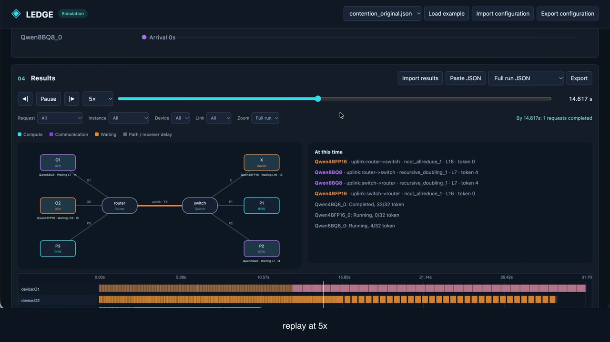

# LEDGE

LEDGE simulates distributed LLM inference from a network topology, model deployments, and a request stream.

[Demo](#demo) · [GUI guide](#gui-guide) · [CLI](#cli) · [Paper examples](#paper-examples)

## Quick Start

Requires Python 3.10+ and NumPy. Run these commands from this directory:

```sh
python3 -m venv .venv
. .venv/bin/activate
pip install -r requirements.txt
python -m simulator serve --port 8765
```

Open <http://127.0.0.1:8765>. The server listens on the local machine. The included parameters are ready to use; model weights and device connections are not required.

GUI runs are stored in `data/runs/`. Press Ctrl+C in the terminal to stop the server.

## Demo

<p align="center">
  <video src="media/ledge-demo.mp4" controls width="960" height="540" poster="media/ledge-demo-preview.jpg" title="LEDGE demo (1:58)">
    <a href="media/ledge-demo.mp4">
      
    </a>
  </video>
</p>

Edit devices, model instances, and requests; run three instances; inspect metrics and timelines; replay execution and export results. The video includes English captions and has no audio.

## GUI guide

Use **Load example** or **Import configuration** to supply an experiment JSON file containing the topology, deployments, and requests. **Export configuration** saves your edits.

| Category | What you can change |
|---|---|
| Network topology | Add, connect, remove, and move devices, routers, and switches. The Inspector edits node/link IDs, device types, profiles, and overrides. |
| Model deployment | Select models, TP/PP/Single parallelism, ordered workers, controller, split ratios or PP layer counts, and collective policy. |
| Requests | Edit arrival times, input/output tokens, batch size, and microbatch size; import CSV or JSON request lists. **Microbatch size should equal or larger than input tokens**|
| Parameters | Edit the parameter mapping and device/link overrides, or keep the included defaults. |

Click **Validate configuration**, choose **Summary** or **Detailed** logging, and click **Run simulation**. **Cancel run** stops a run; **Details** shows its status.

Results show request latency, TTFT, TPOT, token timestamps, and request milestones. Detailed logging adds a filterable event timeline and topology replay; **History** reopens saved runs and compares their metrics.

Import saved result JSON, or export a full run, metrics JSON, request CSV, or resolved configuration. Full run JSON and CLI result JSON can be reimported for replay.

## CLI

Run an example and save its results:

```sh
python -m simulator run simulator/examples/case_H_H.json --output result.json
```

See [CLI_README.md](CLI_README.md) for all options, logging modes, CSV export, batch runs, and output schemas.

## Paper examples

The examples reproduce configurations from *LEDGE: An Efficient Simulator for Distributed LLM Serving on Heterogeneous Edge Devices*. They use the included defaults and the paper's network and device settings. Running an example evaluates that fixed configuration. Large workloads default to Summary logging in the GUI.

### Shared-link contention (Section 4.5)

Both examples launch three disjoint TP2 groups simultaneously. In model order Qwen3-4B Q8_0, Qwen3-4B FP16, and Qwen3-8B Q8_0, the batches are 1, 32, and 8; every sequence has 32 input and 32 output tokens. The respective TP splits are 50/50, 50/50, and 75/25. O1, O2, and P3 attach to the router; X, P1, and P2 attach through a shared switch uplink. Device labels follow the paper.

| Example | Workers in model order | Reference mean E2E |
|---|---|---:|
| [contention_original.json](simulator/examples/contention_original.json) | (P1, P3), (O2, X), (O1, P2) | 24.004 s |
| [contention_optimal.json](simulator/examples/contention_optimal.json) | (P2, P3), (O1, O2), (X, P1) | 20.622 s |

`contention_original` uses the placement selected from independent group costs, evaluated under concurrent arrivals. `contention_optimal` uses the contention-aware placement. Only the concurrent workloads are included.

### Network topology and scaling (Section 4.6, Figure 5)

These examples use Qwen3-14B FP16, equally partitioned over RPi5 workers, with `device1` as controller. One request has 128 input and 64 output tokens. Access links and switch uplinks are 1 Gbps; each switch serves up to eight workers.

| Example | Topology | Workers | Reference E2E |
|---|---|---:|---:|
| [scaling_direct_8.json](simulator/examples/scaling_direct_8.json) | Router-connected workers | 8 | 30.86 s |
| [scaling_direct_64.json](simulator/examples/scaling_direct_64.json) | Router-connected workers | 64 | 19.36 s |
| [scaling_switch_8.json](simulator/examples/scaling_switch_8.json) | One switch | 8 | 30.86 s |
| [scaling_switch_64.json](simulator/examples/scaling_switch_64.json) | Eight switches | 64 | 61.09 s |

### Cross-scenario case study (Section 5, Figure 6 and Table 1)

All 16 examples use Qwen3-8B Q8_0 and eight workers at four two-device sites in a star topology. Worker service-rate multipliers for d0 through d7 are `1, 1, 1.5, 1.5, 2, 2, 1.5, 1.5`.

| Code | Environment | Device profile | Links: Mbps / startup ms | Input/output tokens | Arrivals | Objective |
|---|---|---|---|---|---|---|
| H | Smart home | RPi5 | 1000 / 0.05 | 64 / 32 | 1 request | Minimum E2E |
| O | Office | Orin | 1000 / 0.05 | 256 / 512 | 16 requests, 62.5 ms apart | Maximum throughput |
| F | Field operation | Orin | 10 / 2 | 128 / 32 | 1 request | Minimum E2E |
| M | Infrastructure monitoring | RPi5 | 10 / 2 | 1024 / 16 | 48 requests, 60 s apart | Maximum deadline goodput |

The four fixed deployments all use d4 as controller:

| Deployment code | Workers and parallelism | Partition |
|---|---|---|
| H | TP4 on d0, d2, d4, d6 | 1 : 1.5 : 2 : 1.5 |
| O | TP2 on d4, d5 | 1 : 1 |
| F | PP2, d5 then d4 | 24 / 13 layers, including the output head |
| M | PP2, d4 then d5 | 18 / 19 layers, including the output head |

Files are named `case_<environment>_<deployment>.json`: the first code selects the environment and request stream, and the second identifies the environment whose optimized deployment is reused. For example, `case_O_F` applies the Field-selected deployment to Office.

| Environment | H deployment | O deployment | F deployment | M deployment |
|---|---|---|---|---|
| Smart home | [case_H_H](simulator/examples/case_H_H.json) | [case_H_O](simulator/examples/case_H_O.json) | [case_H_F](simulator/examples/case_H_F.json) | [case_H_M](simulator/examples/case_H_M.json) |
| Office | [case_O_H](simulator/examples/case_O_H.json) | [case_O_O](simulator/examples/case_O_O.json) | [case_O_F](simulator/examples/case_O_F.json) | [case_O_M](simulator/examples/case_O_M.json) |
| Field operation | [case_F_H](simulator/examples/case_F_H.json) | [case_F_O](simulator/examples/case_F_O.json) | [case_F_F](simulator/examples/case_F_F.json) | [case_F_M](simulator/examples/case_F_M.json) |
| Monitoring | [case_M_H](simulator/examples/case_M_H.json) | [case_M_O](simulator/examples/case_M_O.json) | [case_M_F](simulator/examples/case_M_F.json) | [case_M_M](simulator/examples/case_M_M.json) |

Reference results for the diagonal examples are **8.27 s** E2E (H), **0.0346 requests/s** throughput (O), **6.40 s** E2E (F), and **47/48** requests within the deadline, or **0.610 requests/min** goodput (M). Office throughput is request count divided by the span from first arrival to last completion. Monitoring counts requests with response time at most 1800 s and divides by the fixed 4620 s evaluation window; multiply by 60 for requests/min. These rates can be computed from the exported request results.

## Returned values and file formats

Results contain per-request records in `requests` and aggregates in `summary`. The main timing fields are in seconds:

| Field | Meaning |
|---|---|
| `requests[].response_s` | End-to-end request latency, including queueing. |
| `requests[].service_s`, `requests[].queue_s` | Service time and time waiting before service. |
| `requests[].ttft_s` | Time from arrival to the first output token. |
| `requests[].tpot_s` | Mean interval between output tokens; `null` for a single output token. |
| `duration_s` | Latest simulated request completion timestamp. |
| `wall_time_s` | Actual time spent running the simulator. |

Full result JSON supports GUI import and replay when Detailed logging was recorded. CSV exports provide per-request timing; see [CLI_README.md](CLI_README.md#returned-values-and-file-formats) for the complete fields and file formats.
